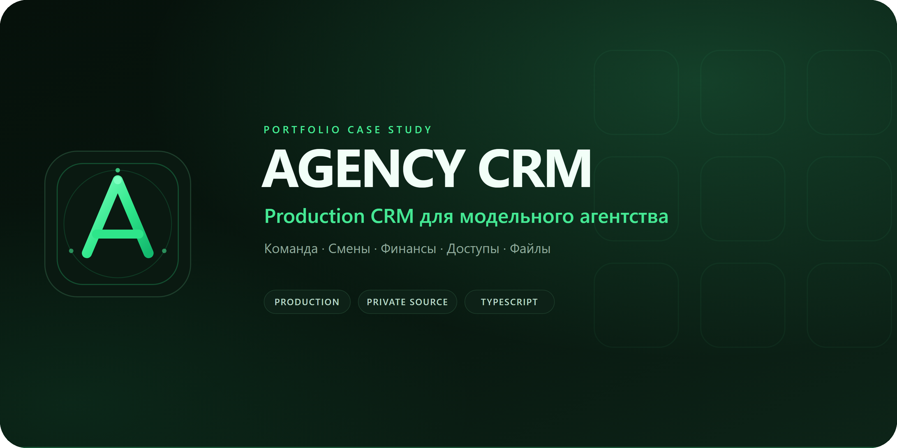
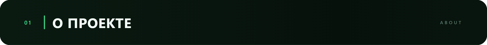
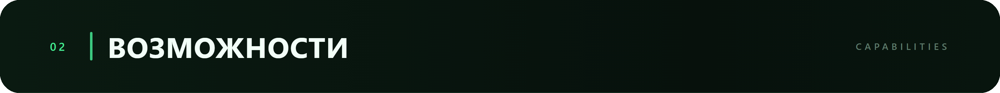
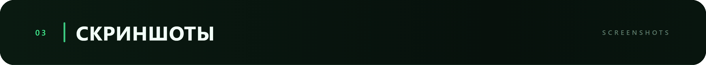
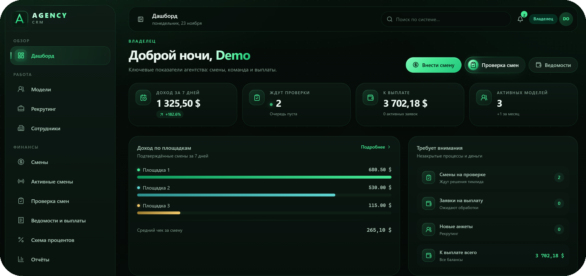
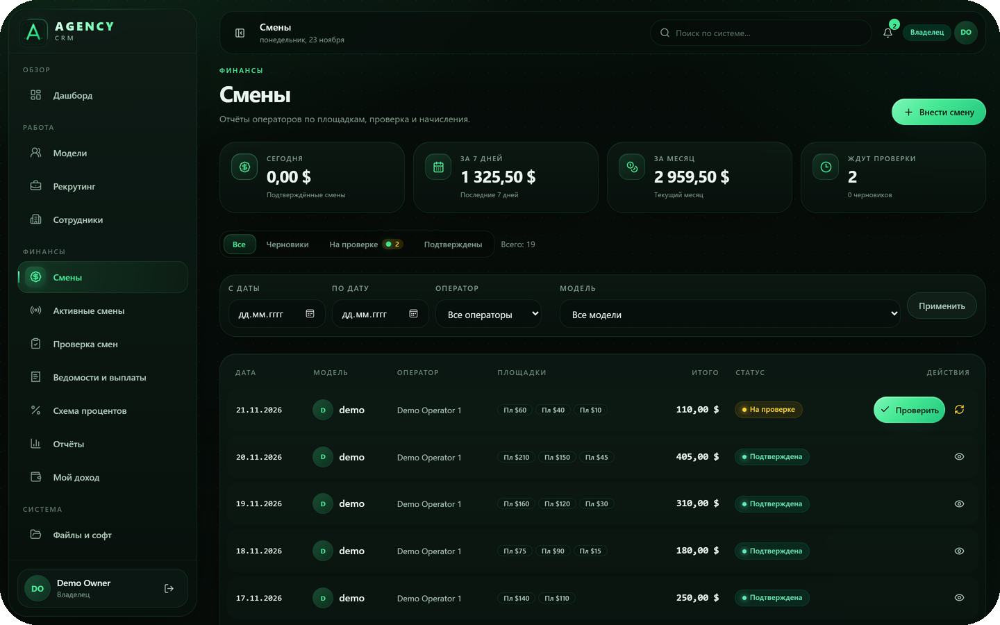
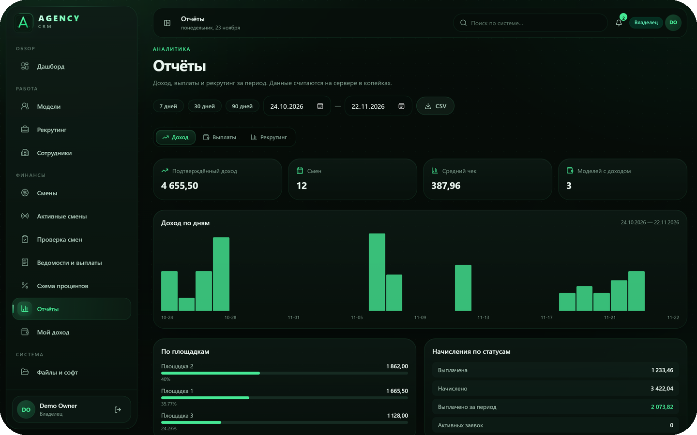
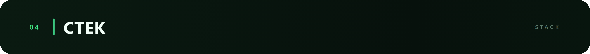
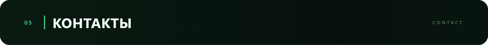

  <picture>
    <source media="(max-width: 700px)" srcset="assets/header-m.webp" type="image/webp">
    <source media="(max-width: 700px)" srcset="assets/header-m.png">
    <source srcset="assets/header.webp" type="image/webp">
    
  </picture>

  

  
  &nbsp;
  

  <picture>
    <source media="(max-width: 700px)" srcset="assets/mobile/sections/01-about.webp" type="image/webp">
    <source media="(max-width: 700px)" srcset="assets/mobile/sections/01-about.png">
    <source srcset="assets/sections/01-about.webp" type="image/webp">
    
  </picture>

**Production CRM для модельного агентства.** Команда, смены, финансы, доступы и рабочие материалы — в одной системе с ролевой моделью, прозрачной историей и аудитом.

*Production CRM for a model agency. Source is private; demo access on request.*

| | |
|:---|:---|
| **Назначение** | Управление модельным агентством |
| **Стек** | Next.js · NestJS · PostgreSQL |
| **Статус** | Production |
| **Доступ** | Исходный код приватный · демо по запросу |

  <picture>
    <source media="(max-width: 700px)" srcset="assets/mobile/sections/02-features.webp" type="image/webp">
    <source media="(max-width: 700px)" srcset="assets/mobile/sections/02-features.png">
    <source srcset="assets/sections/02-features.webp" type="image/webp">
    
  </picture>

| Блок | Что внутри |
|:---|:---|
| **Команда** | Модели, кандидаты, сотрудники и отдельный раздел уволенных |
| **Доступы** | 7 ролей, иерархия и ограничение данных по зоне ответственности |
| **Смены** | Внесение, проверка тимлидом, статусы и привязка к моделям и площадкам |
| **Финансы** | Схемы распределения, начисления, балансы, ведомости и выплаты |
| **Отчёты** | Доход по периодам, площадкам, моделям и операторам |
| **Безопасность** | Обязательная 2FA, подтверждение email, приглашения и EULA |
| **Файлы и софт** | Зашифрованные файлы и внешние ссылки с выдачей по ролям |
| **Аудит** | История критичных действий: кто, что и когда изменил |

  <picture>
    <source media="(max-width: 700px)" srcset="assets/mobile/sections/03-screenshots.webp" type="image/webp">
    <source media="(max-width: 700px)" srcset="assets/mobile/sections/03-screenshots.png">
    <source srcset="assets/sections/03-screenshots.webp" type="image/webp">
    
  </picture>

  <b>Дашборд владельца</b> 
  Доход, смены и выплаты в одном экране

  

  <b>Финансы</b> 
  От подтверждённой смены до выплаты

  

  <b>Отчёты</b> 
  Доход по площадкам и периодам

  

  <picture>
    <source media="(max-width: 700px)" srcset="assets/mobile/sections/04-stack.webp" type="image/webp">
    <source media="(max-width: 700px)" srcset="assets/mobile/sections/04-stack.png">
    <source srcset="assets/sections/04-stack.webp" type="image/webp">
    
  </picture>

  <code>Next.js 16</code> · <code>React</code> · <code>TypeScript</code> · <code>NestJS</code> · <code>Prisma</code> · <code>PostgreSQL</code> · <code>Caddy</code> · <code>Cloudflare</code>

  <b>2FA</b> · <b>AES-256-GCM</b> · <b>Audit</b> · <b>RBAC</b>

  <picture>
    <source media="(max-width: 700px)" srcset="assets/mobile/sections/05-contact.webp" type="image/webp">
    <source media="(max-width: 700px)" srcset="assets/mobile/sections/05-contact.png">
    <source srcset="assets/sections/05-contact.webp" type="image/webp">
    
  </picture>

  <a href="https://github.com/Awaynos">GitHub — @Awaynos</a> 
  Демо-доступ — по запросу 
  Исходный код — приватный

---

  Материалы витрины — <a href="LICENSE">CC BY-NC-ND 4.0</a>: можно делиться со ссылкой на источник, нельзя использовать коммерчески и изменять. Исходный код CRM не публикуется и лицензируется отдельно.

